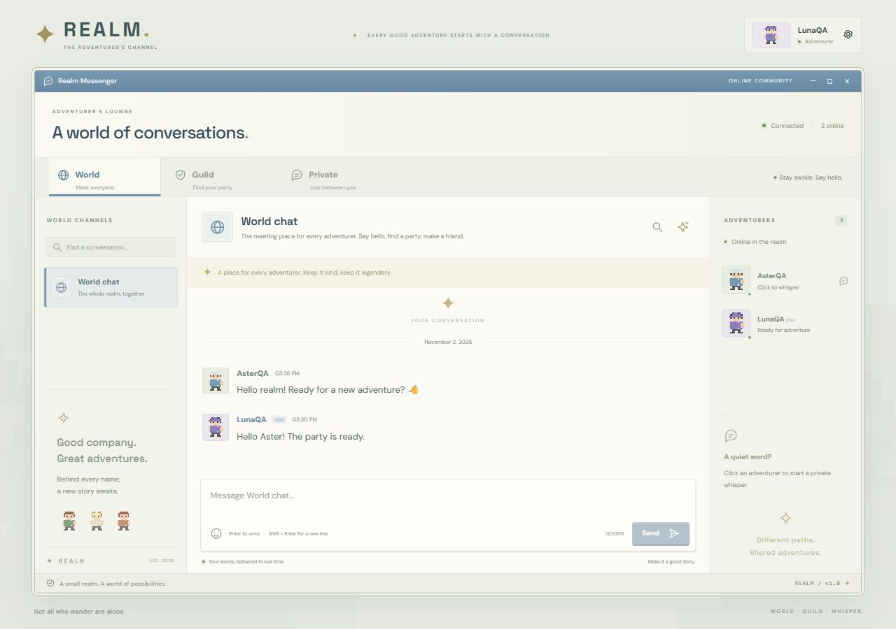

# Realm — MMORPG Chat

เว็บแชทธีมพิกเซลย้อนยุค อิงบรรยากาศหน้าต่าง Ragnarok มี World, Guild และ Private ใช้ React + TypeScript, Node.js, WebSocket และ SQLite หน้าจอภาษาอังกฤษและรับข้อความภาษาไทยได้

**สถานะ:** สร้างแอปที่รันในเครื่องได้แล้ว มีการทดสอบเซิร์ฟเวอร์และตรวจหน้าจอจริง ยังไม่ได้ deploy ออนไลน์ และยังไม่ได้ทดสอบ OpenRouter จริงด้วย API key ของผู้ใช้ ไม่มีบัญชีสำเร็จรูปในฐานข้อมูลเริ่มต้น ให้สมัครผ่านหน้าเว็บ



ดู [ภาพมือถือ](docs/screenshots/realm-mobile.png) และ [ผลตรวจพร้อมข้อจำกัด](docs/VALIDATION.md)

## เริ่มใช้งาน

ต้องมี **Node.js 24 ขึ้นไป** และ npm ตรวจด้วย `node --version`

```powershell
npm ci
npm run dev
```

เปิด **http://localhost:3000** แล้วเลือก **Create Account** ใช้ชื่อ 3–24 ตัวอักษร (ตัวอักษร ตัวเลข `_` หรือ `-`) และรหัสผ่าน 8–128 ตัวอักษร ไม่ใช้อีเมล ใช้ชื่อนี้เป็นชื่อตัวละคร เลือกรูปพิกเซลได้จาก 6 แบบ

โหมดพัฒนาอัปเดตหน้า React/CSS ผ่าน Vite เมื่อแก้ไฟล์ ถ้าแก้โค้ดฝั่ง `server/` ให้หยุดและเปิดคำสั่งใหม่ เพื่อไม่ให้ตัวเฝ้าดูไฟล์ของ Node ไปรีสตาร์ตวนจากไฟล์ config ชั่วคราวของ Vite

สำหรับรันเวอร์ชัน build:

```powershell
npm run build
npm start
```

กด `Ctrl+C` ในหน้าต่างที่รันเพื่อหยุดเซิร์ฟเวอร์ ไม่เปิด `npm run dev` กับ `npm start` บน port เดียวกันพร้อมกัน

## วิธีทดลอง

1. สมัครบัญชี A ในเบราว์เซอร์ปกติ และบัญชี B ในเบราว์เซอร์อื่นหรือหน้าต่างไม่ระบุตัวตน ใช้คนละบริบท cookie; การเปิดสองแท็บปกติจะเป็นบัญชีเดียวกัน
2. กด **Join World Chat** ของแต่ละบัญชี แล้วทดลองส่งข้อความ รายชื่อออนไลน์ต้องรวมตัวเอง
3. ไป **Guild → Explore Guilds / Browse Guilds → Create Guild** กิลด์ใหม่มีผู้สร้างคนเดียว อีกบัญชีดูชื่อ คำอธิบาย เจ้าของ และสมาชิกได้ แล้วกด **Join** เอง
4. เมื่อเข้ากิลด์ อ่านข้อความก่อนเข้าร่วมได้ทั้งหมด สมาชิกออกผ่าน **Guild settings → Leave Guild** ได้
5. เจ้าของใช้ **Transfer Ownership** ให้สมาชิกปัจจุบันได้ จากนั้นเจ้าของเดิมกลายเป็นสมาชิกและออกได้ ถ้ายังเป็นเจ้าของต้องโอนหรือยุบก่อนออก
6. **Disband Guild** มีหน้าถามยืนยันและปิดห้องสำหรับทุกคน ประวัติยังเก็บในฐานข้อมูล แต่ผู้เล่นเปิดอ่านไม่ได้ ไม่มีหน้ากู้คืนในเวอร์ชันนี้
7. คลิกผู้เล่นในรายชื่อเพื่อ **Private** หรือใช้ **New Whisper** ห้องคู่เดิมจะใช้ห้องเดิม รองรับฝากข้อความเมื่ออีกคนออฟไลน์
8. ลองให้บัญชี C เปิดอ่าน Private ของ A/B ผ่านรหัสห้องโดยตรง เซิร์ฟเวอร์ต้องปฏิเสธ ไม่ใช่แค่ซ่อนปุ่ม
9. **Enter** ส่งข้อความ, **Shift+Enter** ขึ้นบรรทัดใหม่ มีปุ่มเลือกอีโมจิ ข้อความร่างแยกตามห้องและไม่ถูกล้างเมื่อส่งล้มเหลว
10. ปุ่มแว่นขยายค้นหาทั้งประวัติของห้องปัจจุบัน แบ่งผลครั้งละ 50 รายการ ปุ่มอ่านข้อความก่อนหน้าโหลดประวัติเพิ่มได้

ข้อความยังไม่อ่านนับแยกแต่ละห้องและเก็บตำแหน่งอ่านต่อบัญชี หากกำลังอ่านข้อความเก่าหรือซ่อนแท็บ จะยังไม่นับว่าอ่านข้อความใหม่จนกลับมาเห็นท้ายห้อง ข้อความที่ตัวเองส่งไม่นับเป็นยังไม่อ่าน

มือถือใช้ปุ่ม **Channels** และ **Players** เพื่อเปิดแผงด้านข้าง การเปลี่ยนรูปตัวละครหรือออกจากระบบอยู่ที่ปุ่มชื่อผู้เล่นมุมขวาบน

## การตั้งค่า

คัดลอกไฟล์ตัวอย่างเมื่อต้องการเปลี่ยนค่า (อย่าทับ `.env` เดิมที่มี key):

```powershell
Copy-Item .env.example .env
```

| ตัวแปร | ค่าเริ่มต้น / หน้าที่ |
| --- | --- |
| `HOST` | `0.0.0.0` รับจากเครื่องอื่นในเครือข่ายได้ ใช้ `127.0.0.1` ถ้าต้องการเปิดเฉพาะเครื่องนี้ |
| `PORT` | `3000` หรือ port ที่โฮสต์กำหนด |
| `DATABASE_PATH` | `./data/realm.sqlite` ตำแหน่ง SQLite ฝั่งเซิร์ฟเวอร์ |
| `PUBLIC_ORIGIN` | ไม่กำหนดในเครื่อง; ออนไลน์ตั้งเป็น URL จริง เช่น `https://chat.example.com` ไม่มี `/` ท้าย เพื่อใช้ตรวจ Origin |
| `COOKIE_SECURE` | `false` สำหรับ HTTP ในเครื่อง; ออนไลน์ผ่าน HTTPS ตั้ง `true` |
| `OPENROUTER_API_KEY` | ไม่กำหนดก็แชทได้ เพิ่มเฉพาะเมื่อจะเปิด AI |
| `AI_MODEL` | `openrouter/free` หรือ model ID ที่ลงท้าย `:free` เท่านั้น |

ค่าจาก environment ของโฮสต์มีผลเหนือ `.env` ต้อง restart หลังเปลี่ยนค่า ห้ามใส่ key ในตัวแปรที่ขึ้นต้น `VITE_` เพราะจะถูกส่งไปหน้าเว็บ `.env` และข้อมูลจริงถูก ignore จาก Git

## เก็บข้อมูลและสำรองข้อมูล

SQLite เก็บ **บัญชี, password hash, session, ห้อง, สมาชิก, ข้อความ, ตำแหน่งอ่านล่าสุด และ cache สรุป AI** ส่วนออนไลน์และกำลังพิมพ์เก็บชั่วคราวในหน่วยความจำ

ไฟล์ `realm.sqlite`, `realm.sqlite-wal`, `realm.sqlite-shm` อาจอยู่ด้วยกันระหว่างใช้งาน ข้อมูลไม่อยู่ในเบราว์เซอร์ การล้าง browser storage ไม่ได้ลบประวัติจากเซิร์ฟเวอร์

สำรองอย่างสอดคล้องกันด้วย SQLite backup API แม้เซิร์ฟเวอร์กำลังทำงาน:

```powershell
npm run backup
# หรือระบุไฟล์ปลายทางใหม่ที่ยังไม่มี
npm run backup -- ./backups/before-demo.sqlite
```

คำสั่งไม่ทับไฟล์สำรองที่มีอยู่แล้ว ห้ามถือว่าคัดลอกเฉพาะ `.sqlite` ขณะกำลังเขียนเป็น backup ที่ครบเสมอ เพราะอาจมีข้อมูลอยู่ใน WAL

กู้คืน: หยุดเซิร์ฟเวอร์ก่อน เก็บไฟล์ฐานข้อมูลเดิมและไฟล์ WAL/SHM ที่เกี่ยวข้องไว้อีกโฟลเดอร์ แล้วนำไฟล์สำรองไปไว้ตำแหน่ง `DATABASE_PATH` โดยไม่เหลือ WAL/SHM ของชุดเดิมข้างไฟล์ที่กู้ ก่อนเปิดเซิร์ฟเวอร์ใหม่ ห้ามลบหรือแทนฐานข้อมูลที่ยังใช้งานอยู่

## ต่อ OpenRouter ฟรี

1. สมัคร OpenRouter และสร้าง API key ใน [หน้า API keys](https://openrouter.ai/settings/keys) ไม่ต้องส่ง key ในแชท
2. ตั้งค่าฝั่งเซิร์ฟเวอร์:

```dotenv
OPENROUTER_API_KEY=your_key_here
AI_MODEL=openrouter/free
```

3. Restart แล้วเปิดห้องที่เป็นสมาชิก กดปุ่ม **Summarize chat** อ่านคำแจ้งการส่งข้อมูลภายนอกและติ๊กยินยอม ก่อนกด **Summarize Conversation**

ระบบส่งเฉพาะข้อความล่าสุดในห้อง สูงสุด 40 ข้อความและ 14,000 ตัวอักษรของเนื้อหา ผลแสดงแก่ผู้เรียกในหน้าต่าง AI ไม่โพสต์ลงห้องอัตโนมัติ มี cache ตามข้อความล่าสุดและโมเดล จำกัดการเรียกซ้ำต่อบัญชีและทั้งระบบ และปฏิเสธ model ID แบบเสียเงิน

โมเดล `openrouter/free` อาจเปลี่ยนตัวที่รับงาน หากต้องการอธิบายโมเดลเดียวในสไลด์ ให้ทดสอบและกำหนด model ID `:free` ที่ใช้จริงภายหลัง โควตาใช้ร่วมกันทุกคนที่เรียกผ่าน key ของเซิร์ฟเวอร์ และเมื่อ AI ล้มเหลวหรือครบโควตา แชทหลักยังใช้งานได้ ดู [โมเดลฟรีและโควตาทางการ](https://openrouter.ai/collections/free-models)

ยังไม่ได้เรียกบริการจริงในขั้นพัฒนาโดยไม่มี key จึงไม่รับประกันความเร็ว ความพร้อมใช้ หรือคุณภาพสรุป ควรทดสอบข้อความจำลองก่อนสาธิต และบันทึกชื่อโมเดลที่ใช้จริงตามโจทย์

## ทดลองจากสองเครื่องผ่าน LAN

1. ให้ทั้งสองเครื่องอยู่เครือข่ายเดียวกัน และรันเซิร์ฟเวอร์เครื่องเดียวด้วย `HOST=0.0.0.0`
2. ดู IPv4 ของเครื่องเซิร์ฟเวอร์ด้วย `ipconfig` เช่น `192.168.1.20`
3. เครื่องอื่นเปิด `http://192.168.1.20:3000` แล้วใช้คนละบัญชี ทุก client ใช้ URL เดียวกัน
4. ถ้า firewall ถาม ให้เปิดรับเฉพาะเครือข่ายที่เหมาะกับการทดลอง ไม่ต้องเปิด port ฐานข้อมูล เพราะ SQLite ใช้เฉพาะฝั่งเซิร์ฟเวอร์

อย่าตั้ง `COOKIE_SECURE=true` บน LAN แบบ HTTP และถ้าใช้ `PUBLIC_ORIGIN` ต้องตรงกับ URL ที่ client ใช้จริง หาก Wi-Fi แยก client ออกจากกัน ให้เปลี่ยนเครือข่ายที่อนุญาตให้เครื่องติดต่อกันได้

## นำขึ้นอินเทอร์เน็ต

**ยังไม่ได้นำขึ้นออนไลน์** โฮสต์ต้องรัน Node.js 24 รับ WebSocket ได้ และมีพื้นที่ไฟล์ถาวรสำหรับ SQLite ใช้ app instance เดียวในเวอร์ชันนี้ ดูผลสำรวจใน [docs/HOSTING.md](docs/HOSTING.md) ซึ่งยังเป็นตัวเลือกที่ต้องทดสอบ ไม่ใช่บริการที่ยืนยันใช้แล้ว

สิ่งที่ต้องเตรียมภายหลังคือบัญชีโฮสต์ฟรีที่ไม่ใช้บัตร, URL HTTPS/WSS, พื้นที่ถาวร และ API key ถ้าเปิด AI ไม่จำเป็นต้องซื้อโดเมนหากใช้ subdomain ของผู้ให้บริการ

คำสั่งบนโฮสต์ทั่วไป:

```sh
npm ci
npm run build
# ตั้ง HOST / PORT / DATABASE_PATH / PUBLIC_ORIGIN / COOKIE_SECURE ผ่านโฮสต์
npm start
```

ตั้ง `DATABASE_PATH` เป็นตำแหน่งนอก release ที่จะถูกแทนตอน deploy, `PUBLIC_ORIGIN` เป็น URL จริง และ `COOKIE_SECURE=true` ผ่าน HTTPS ตั้ง proxy ให้รองรับ WebSocket และส่งหน้าเว็บ/API/socket ภายใต้ origin เดียวกัน มีตัวอย่าง [Caddyfile](deploy/Caddyfile.example) สำหรับเครื่องที่จัดการ proxy เอง

Docker image ผ่านการ build และทดสอบจริงแล้ว รวม HTTP/WebSocket, การเขียน SQLite, backup ขณะใช้งาน และการคง session/ประวัติหลัง restart:

```sh
docker build -t realm-chat:local .
docker run --name realm-chat -p 3000:3000 -v realm-data:/data realm-chat:local
```

คำสั่งข้างต้นเปิดแชทแบบไม่ใช้ AI ได้ทันที หากต้องการส่งค่าจาก `.env` ให้เพิ่ม `--env-file .env` ก่อนชื่อ image และแก้ `DATABASE_PATH` ในไฟล์เป็น `/data/realm.sqlite` เพื่อใช้ volume ที่ mount ไว้ ไม่วางฐานข้อมูลในชั้นไฟล์ container

ทดสอบ Docker หลัง build image ชื่อ `realm-chat:local`:

```powershell
npm run test:docker
```

คำสั่งสร้าง container/volume QA ที่ตั้งชื่อเฉพาะ เปิดเฉพาะ loopback ทดสอบหน้าเว็บ แชท backup และ restart แล้วลบเฉพาะทรัพยากร QA ที่สร้างเอง ไม่ใช้ `data/realm.sqlite` หรือ volume `realm-data` ของผู้ใช้

หน้า React สามารถ build ไป Vercel ได้ แต่ต้องวางแผนการส่ง API/WebSocket ไป backend และ cookie ให้ครบก่อนแยกโฮสต์ โค้ดปัจจุบันออกแบบ origin เดียว ไม่สามารถยกทั้งระบบกับไฟล์ SQLite ไป Vercel Functions โดยตรงแล้วเก็บข้อมูลถาวรได้

## สถาปัตยกรรมและ API

```text
Browser A ── HTTP(S) + WebSocket ──┐
                                  ├── Node.js server ── SQLite
Browser B ── HTTP(S) + WebSocket ──┘        └── OpenRouter (เมื่อเปิด AI)
```

HTTP ใช้บัญชีและคำขอ AI; ข้อความแชท ห้อง รายชื่อผู้เล่น การค้นหา และตำแหน่งอ่านใช้ WebSocket `/socket` ทุกข้อความมี request ID จับคู่คำตอบ และ client message ID กันการส่งซ้ำจาก retry

| HTTP endpoint | หน้าที่ |
| --- | --- |
| `POST /api/register` | สมัครบัญชี |
| `POST /api/login` | ล็อกอิน |
| `GET /api/me` | ตรวจ session |
| `POST /api/logout` | เพิกถอน session และ socket ของ session นั้น |
| `POST /api/profile` | เปลี่ยนรูปจากชุดที่เตรียมไว้ |
| `POST /api/summary` | สรุปข้อความ ต้องเป็นสมาชิกและส่ง `consent: true` |
| `GET /api/health` | ตรวจการตอบสนองของเซิร์ฟเวอร์ |

| WebSocket action | หน้าที่ |
| --- | --- |
| `join`, `createGuild` | เข้าร่วมเอง / สร้างกิลด์ |
| `leave`, `transfer`, `disband` | จัดการกิลด์ตามสิทธิ์ |
| `private` | เปิดห้องเฉพาะคู่ |
| `history`, `search` | อ่านประวัติและค้นหาแบบแบ่งหน้า |
| `message` | ส่งข้อความและบันทึกก่อนตอบรับ |
| `read`, `typing` | ตำแหน่งอ่านและกำลังพิมพ์ |

ตัวอย่าง frame: `{"id":"request-id","action":"history","data":{"roomId":"world"}}`

## ทดสอบและเทียบโจทย์

```powershell
npm run build
npm test
```

ชุดทดสอบใช้ HTTP และ WebSocket จริงกับ SQLite แยกจากข้อมูลใช้งาน ตรวจบัญชี สิทธิ์ Privacy การเข้าร่วมเอง โอน/ออก/ยุบกิลด์ การแบ่งหน้า retry ข้อความ จำนวนยังไม่อ่าน การเปิดเซิร์ฟเวอร์ใหม่ และ AI ด้วย provider จำลอง ไฟล์ทดสอบ persistence อยู่ใน `test-results/` ซึ่งไม่ถูก commit

รอบล่าสุดผ่าน 15 กลุ่ม รวมการทำงานพร้อมกัน 9 บัญชี การปฏิเสธส่งข้อมูลให้ session หมดอายุก่อนรอบ heartbeat และกรณีเชื่อมต่อใหม่หลังมีข้อความตกหล่นเกินหนึ่งหน้า ตรวจการสร้าง request/message ID บน HTTP LAN ซึ่งไม่มี `crypto.randomUUID` ด้วย

| โจทย์ | ตำแหน่งหลัก | สาธิต |
| --- | --- | --- |
| R1 | README และ docs/DESIGN.md | client บนคอมพิวเตอร์จริงอย่างน้อย 2 เครื่อง อธิบาย HTTP/TCP/WebSocket/TLS |
| R2 | server/app.mjs, src/connection.ts | แสดง `/socket` และ action `message` |
| R3 | server/store.mjs, server/app.mjs | สมัครชื่อซ้ำไม่ได้ |
| R4 | snapshot ใน server/app.mjs, รายชื่อผู้เล่นใน src/main.tsx | ออนไลน์สองบัญชีรวมตัวเอง |
| R5–R6 | rooms/members, หน้าต่าง Chat | สลับห้องและช่องพิมพ์แยกกัน |
| R7 | action private/message/history | A/B คุยกัน C เปิดอ่านไม่ได้ |
| R8–R10 | createGuild/join และ Guild Directory | สร้างคนเดียว อีกคนเข้าร่วมเอง ดูกลุ่มและรายชื่อสมาชิกได้ |
| R11 | assertMember และ toRoom | รับส่งเฉพาะสมาชิกกิลด์ |
| ฟีเจอร์พิเศษ | summary, search, read, typing | AI สรุป ค้นหาประวัติ จำนวนยังไม่อ่าน และกำลังพิมพ์ |

## ข้อจำกัดและแก้ปัญหา

- `node:sqlite` ใช้ไม่ได้: ตรวจให้เป็น Node.js 24+ ไม่ใช่เวอร์ชันเก่าที่อยู่ก่อนใน PATH
- เปิดเว็บแล้วไม่พบหน้า: รัน `npm run build` ก่อน `npm start` หรือใช้ `npm run dev`
- `EADDRINUSE`: มีโปรแกรมใช้ port แล้ว หยุดเซิร์ฟเวอร์เดิมหรือเปลี่ยน `PORT`
- `Request origin is not allowed`: ตรวจ `PUBLIC_ORIGIN` ให้ตรง scheme/host/port ไม่มี slash ท้าย และ restart
- ล็อกอินแล้วหลุดบน HTTP: ตรวจว่าไม่ได้เปิด Secure cookie บน HTTP
- ส่งไม่ได้ตอน reconnect: รอเชื่อมต่อแล้วกด Retry ใช้ message ID เดิมเพื่อไม่บันทึกซ้ำ ข้อความร่างจะไม่ถูกล้างเมื่อส่งล้มเหลว
- AI ใช้ไม่ได้: ตรวจ key, model ID ฟรี, การตั้งค่า provider และโควตา ไม่เปิดใช้โมเดลเสียเงินแทนโดยอัตโนมัติ
- ไม่มีอีเมลกู้รหัสผ่าน ไม่มีอัปโหลดไฟล์ ไม่มี reply/edit/delete ข้อความ ไม่มี E2E encryption ผู้ที่เข้าถึงเซิร์ฟเวอร์/ฐานข้อมูลอ่านข้อความได้
- เป้าหมายปัจจุบันคือผู้ใช้พร้อมกันไม่ถึง 10 คน ผ่านการทดสอบ 9 บัญชีพร้อมกันบนเครื่องเดียว และสมัคร/เข้าห้อง/ส่งข้อความผ่าน IP ของ Wi-Fi จากเบราว์เซอร์แล้ว ยังไม่ใช่ผลทดสอบคอมพิวเตอร์จริงคนละเครื่องหรือโฮสต์ออนไลน์จริง
- ฟอนต์ตกแต่งโหลดจาก Google Fonts ถ้าไม่มีอินเทอร์เน็ตจะใช้ฟอนต์สำรองในเครื่อง ฟังก์ชันแชทไม่พึ่งบริการฟอนต์

รายละเอียดแนวคิดอยู่ใน [docs/DESIGN.md](docs/DESIGN.md) และหน้าต่าง UI อิงบรรยากาศ MMORPG โดยใช้ภาพพิกเซล/SVG ที่สร้างสำหรับโปรเจกต์นี้
