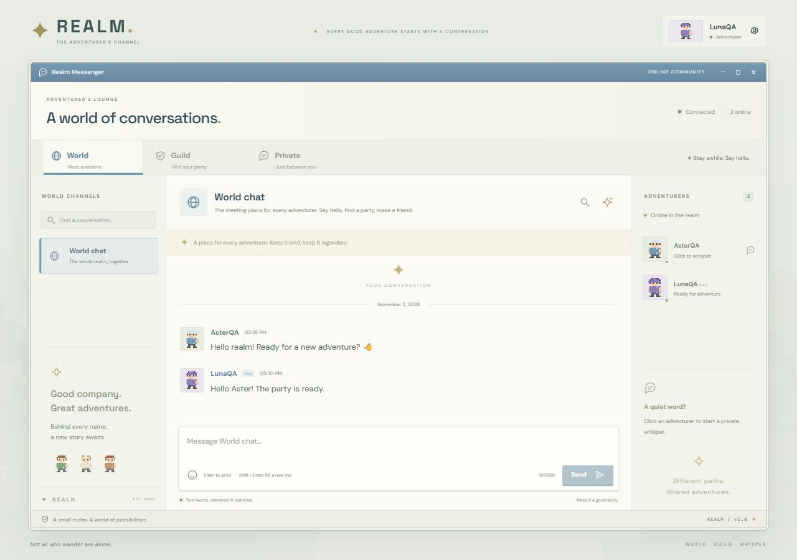

# ผลตรวจเวอร์ชันในเครื่อง

วันที่: 2 พฤศจิกายน 2026

## การตรวจอัตโนมัติ

- `npm run build`: ผ่าน TypeScript และ Vite production build
- `npm test`: ผ่าน 15 กลุ่ม ไม่มีรายการล้มเหลว
- `docker build --tag realm-chat:local .`: ผ่านบน Linux engine ของ Docker Desktop
- `npm run test:docker`: ผ่าน HTTP/WebSocket, SQLite write, live backup, restart และ persisted session/history โดยแยก QA container/volume และลบทิ้งหลังตรวจ
- ตรวจ syntax ของ server/app.mjs, server/store.mjs และ scripts/backup.mjs: ผ่าน

ชุดทดสอบครอบคลุม:

1. สมัคร/ล็อกอิน ชื่อซ้ำ รหัสผ่านผิด session การตรวจ origin และการออกจากระบบ
2. ปฏิเสธ WebSocket ที่ไม่ล็อกอินหรือมาจาก origin อื่น
3. World ต้องเข้าร่วมเอง Private ไม่ถึงบัญชีที่สาม และลองส่งด้วย client message ID เดิมไม่สร้างข้อความซ้ำ
4. กิลด์ใหม่มีเจ้าของคนเดียว สมาชิกใหม่อ่านประวัติทั้งหมดได้ โอนเจ้าของ ออก และยุบแบบ archive โดยปฏิเสธสิทธิ์เดิมหลังเปลี่ยนสมาชิก
5. ประวัติและการค้นหาเกิน 50 ข้อความ จำนวนยังไม่อ่าน และการไม่ยอมให้ read cursor ข้ามข้อความในอนาคต
6. Typing ส่งเฉพาะสมาชิก และคำขอผิดรูปแบบไม่ทำให้เซิร์ฟเวอร์หยุด
7. เปิดเซิร์ฟเวอร์ใหม่แล้วยังมีบัญชี session ข้อความ และตำแหน่งอ่าน รวมทดสอบคำสั่ง backup ขณะฐานข้อมูลเปิดอยู่
8. AI quota 429 ไม่ทำให้แชทเสีย และสมาชิกที่ออกจากกิลด์ระหว่างรอผลไม่ได้รับสรุป
9. AI ต้องมี consent/สิทธิ์ ใช้โมเดลฟรีตามการตั้งค่า และใช้ cache แทนการเรียกซ้ำ
10. ผู้ใช้พร้อมกัน 9 บัญชี ส่ง World รวม 27 ข้อความและอีก 2 ข้อความใน Guild/Private ตรวจ 249 การส่งถึงสมาชิกที่คาดไว้ โดยไม่ซ้ำและไม่รั่วข้ามห้อง
11. Session หมดอายุไม่ได้รับข้อความใหม่ แม้ยังไม่ถึงรอบ heartbeat
12. ชื่อบัญชี UTF-8 ไม่เสียเมื่อ HTTP body ถูกแบ่งกลางอักขระหลายไบต์
13. การสร้างรหัสบน HTTP LAN ที่ไม่มี randomUUID ได้รูปแบบที่ถูกต้องและไม่ซ้ำในตัวอย่างทดสอบ
14. Reconnect หลังข้อความตกหล่นเกิน 50 ข้อความยังแบ่งหน้าอ่านช่วงที่ขาดต่อได้
15. ข้อความสดที่เข้ามาระหว่างโหลด history ไม่หายและไม่ปรากฏซ้ำ

ข้อมูลทดสอบใช้ SQLite แยกจาก `data/realm.sqlite` ไฟล์ทดสอบ persistence/backup อยู่ใน `test-results/` ซึ่งไม่ถูก commit

## การตรวจผ่านเบราว์เซอร์จริง

ใช้ฐานข้อมูลทดลองและบัญชี AsterQA/LunaQA บนเครื่องเดียว เปิดผ่าน localhost กับ 127.0.0.1 เพื่อแยก cookie ไม่ใช่การทดสอบคอมพิวเตอร์จริงสองเครื่อง

- สมัครบัญชี เลือกรูปพิกเซล และเข้าสู่ระบบ
- กดเข้าร่วม World ด้วยตัวเองและส่งข้อความ/อีโมจิด้วย Enter
- ข้อความระหว่างสองบัญชีปรากฏทันที และตัวเลขยังไม่อ่านขึ้นเมื่อผู้รับเปิดห้องอื่น
- Private เปิดห้องคู่สนทนาได้ และจำนวนยังไม่อ่านหายเมื่อเปิดอ่าน
- ค้นหาข้อความที่บันทึกไว้ได้จากหน้าค้นหา
- กิลด์ว่างแสดงปุ่มสำรวจ สร้างกิลด์ใหม่ได้ และบัญชีที่สองเข้าร่วมเอง
- โอนเจ้าของผ่าน UI ได้ และหลังรีเฟรชผู้รับเห็นสิทธิ์เจ้าของพร้อมชื่อเจ้าของใหม่
- Shift+Enter ขึ้นบรรทัดใหม่โดยไม่ส่ง และ Enter ส่งข้อความได้
- ตรวจ desktop 1280×900 และ mobile 390×844 โดย mobile มี `scrollWidth` เท่ากับความกว้างหน้าจอ ไม่มีล้นแนวนอน และเปิดแผง Channels ได้
- `npm run dev` เปิดหน้าแอปผ่าน Vite middleware ได้ แก้การ restart วนโดยไม่ให้ Node watch รวมไฟล์ชั่วคราวของ Vite
- หลังกลับมาทำต่อ เปิดเว็บผ่าน IP จริงของ Wi-Fi แบบ HTTP สมัคร LANScout, Join World และส่งข้อความไทย/อีโมจิสำเร็จ ตรวจ browser error log ไม่พบรายการ error ทั้งนี้ยังใช้เบราว์เซอร์บนเครื่องเซิร์ฟเวอร์ ไม่ใช่ client คนละเครื่อง

ภาพจากระบบทดลองจริง ไม่ใช่ข้อมูลตัวอย่างที่เติมไว้ในฐานข้อมูลเริ่มต้น:

[ภาพหน้าจอมือถือ](screenshots/realm-mobile.png)

[ภาพตรวจ HTTP LAN หลังแก้รหัสคำขอ](screenshots/realm-lan.png)

## ส่วนที่ยังไม่ตรวจจริง

- ยังไม่มี API key จึงไม่ได้เรียก OpenRouter จริง ผลทดสอบ AI ใช้ provider จำลอง
- ยังไม่เลือกบัญชีโฮสต์และไม่ได้ deploy ออนไลน์ จึงไม่ยืนยัน WSS ผ่าน proxy/โฮสต์จริงหรือการคงข้อมูลบนแพ็กเกจฟรี
- ยังไม่ได้สาธิตผ่านคอมพิวเตอร์จริงคนละเครื่องตาม R1 ให้ใช้ขั้นตอน LAN หรือ URL ออนไลน์ใน README ทดสอบต่อ
- ทดสอบ Docker และ 9 บัญชีบนเครื่องเดียวแล้ว แต่ยังไม่ได้ทดสอบโหลด/เครือข่ายจริงระยะยาวหรือผู้ใช้จริงจากหลายอุปกรณ์
